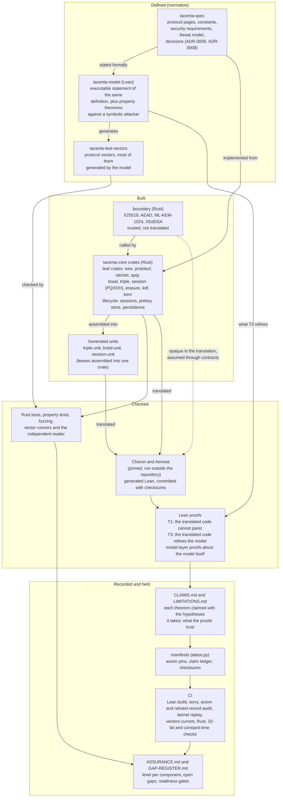

# tacenta-core

A verification-first implementation of selected published Signal Protocol
specifications: a small, standalone cryptographic core with machine-checked
proofs over its verified zone.

## What this is

**The specification is the product.** [tacenta-spec](tacenta-spec/) defines
the protocol, its wire and storage formats, and the rules a reader enforces.
[tacenta-model](tacenta-model/) states the same definition formally, and the
protocol vectors it generates are normative examples of it.
[tacenta-core](tacenta-core/) is one implementation of that specification,
the project's own. Where the implementation and the specification disagree,
the implementation is wrong until the specification is amended, and a change
to anything the specification defines is made to the specification first
([ADR-0006](tacenta-spec/decisions/ADR-0006-specification-is-normative.md)).

The cryptographic foundation behind [Tacenta](https://tacenta.com), built to
stand on its own. It is
protocol, cryptography, and their verification, nothing else: no product
coupling, no application policy, no services. Tacenta is its first consumer, but
it is meant to serve other projects too, the way libsignal does. Each of the
five components is built to lift into its own public repository; they live
together here while the work matures.

This implementation is designed to be inspected and its stated proof claims
reproduced. Its supported protocol surface and interoperability limits are
stated below. It is not yet packaged for installation from a registry; today the
way to engage with it is to read the specification and verify the proofs (see
"Verify it yourself" below).

## Development assistance

Tacenta is developed by human engineers using automated and AI-assisted tools.
Those tools assist implementation, specification text, test harnesses and review
preparation; the project maintainer remains accountable for accepting changes.
Tool-assisted checks and reviews are evidence of what they ran, not independent
review, and assurance records identify their scope and limits.

## The mission

> Build a small, stable, verification-first engine for selected published Signal
> Protocol specifications, with narrowly stated and reproducible compatibility
> results.

Every phrase is a constraint, and each is meant to be falsifiable:

- **Small.** Only security-critical protocol functionality is in the core.
- **Stable.** Tacenta owns and versions its public API.
- **Verification-first.** Specifications, models, and evidence are meant to precede claims;
  `ASSURANCE.md`, practice 1, says where that has not yet been true.
- **Interoperable on the wire.** Match another implementation's protocol
  *behaviour*, not its API architecture. What that covers today is stated below.
- **Explicitly supported versions.** Compatibility is bounded, never
  universal, and no compatibility test against another implementation is recorded yet.
- **No product coupling.** Storage and device abstractions belong; application
  policy and unrelated services do not.

## What is and is not claimed

Two of the constraints above carry limits worth stating plainly.

- **Interoperability reaches the bundle layer, not the message layer.** The
  target is exchanging prekey bundles and establishing a session with a pinned
  libsignal release, with any result claimed by version and covered surface
  (ADR-0004). Ongoing messages are not exchanged across implementations: the
  key-derivation constants sit upstream of
  every message byte, no published specification carries test vectors for them,
  and black-box observation cannot recover them. The target is scoped to the
  bundle layer accordingly, and no cross-implementation run is recorded in this
  tree.
- **Stable is a goal, not a state.** There is no versioning policy, deprecation
  policy, or supported-target matrix yet.

`ASSURANCE.md` says where the project stands on two of the other four
constraints, Small and Verification-first (practices 3 and 1). The other two,
explicitly supported versions and no product coupling, have no assurance row yet.
`tacenta-proofs/CLAIMS.md` is the precise
record of what is proven. Where this README and that document ever disagree,
that document is right.

## Components

- **[tacenta-spec](tacenta-spec/)**, the protocol and security specification,
  written as prose: the normative definition.
- **[tacenta-model](tacenta-model/)**, the executable, formal statement of the
  same specification, and the source of the protocol vectors.
- **[tacenta-proofs](tacenta-proofs/)**, the Lean proofs and a reproducible
  verification environment.
- **[tacenta-test-vectors](tacenta-test-vectors/)**, interoperability vectors
  and conformance tests.
- **[tacenta-core](tacenta-core/)**, one implementation of the specification,
  in Rust.

## How it fits together

The specification is the product, so the picture starts there. Arrows point
from a piece to what consumes it or is built from it.

- **Defined, built, checked, recorded.** The specification and the model say
  what the behaviour is. The Rust crates are one implementation of it. The
  checks ask whether the implementation does what the definition says. The
  record says which of those checks are claimed, what each one assumes, and
  what is still open.
- **Two kinds of evidence about the Rust.** Tests, fuzzing, the vectors the
  model generates and the independent reader show that the code agrees with
  the model on the cases they cover. The Lean proofs are about the translated
  code: T1 says a function cannot panic, T3 says it refines the model. The
  README's Status section says which crates carry which theorems.
- **Units.** The Triple Ratchet, the Braid and the session lifecycle are
  translated as generated units that assemble the leaf crates into one crate,
  so that Charon sees a composition with its leaves instead of over opaque
  axioms. Nothing links against a unit and none is published.
- **Where trust sits.** The boundary crate and the Charon and Aeneas toolchain
  are trusted and not verified here. A proof reaches the boundary through
  contracts that appear as hypotheses of the theorems that take them.
  `tacenta-proofs/LIMITATIONS.md` lists what a reader must still trust, and
  `tacenta-proofs/CLAIMS.md` lists every claimed theorem with its hypotheses.
- **What holds the record in place.** `attest.py` compares the ledger with the
  proofs and pins the axioms each claimed theorem uses, and the CI jobs
  replay the proofs through the kernel and scan for `sorry`. A passing build
  shows the claims hold as stated. It does not show that a hypothesis can be
  met, which is why `GAP-REGISTER.md` keeps the open questions and
  `ASSURANCE.md` keeps the readiness gates.
- **Not in the picture.** The release tags (`tacenta-spec-v*` and
  `tacenta-assurance-v*`), the hostile reviews, and the Tacenta product that
  consumes this repository.

## Status

Eight crates carry T1 panic-freedom and T3 refinement theorems over their
translated Rust: `tacenta-wire` (the decoders), `tacenta-ratchet`,
`tacenta-session` (the PQXDH derivation only), `tacenta-spqr`, `tacenta-braid`,
`tacenta-triple`, `tacenta-protobuf` and `tacenta-erasure` (T1 for the coder, T3
for the field arithmetic only). A ninth, `tacenta-lifecycle`, has conditional
panic-freedom theorems on the eight-leaf session unit, three of which took a record with a false
field until it was restated (`GAP-REGISTER.md`, row `SESSION-CONTRACT-VACUITY`; the records are shown inhabited only in the sense
and under the laws recorded in `tacenta-proofs/LIMITATIONS.md`; their headroom records are shown satisfiable in the same sense, with further assumptions recorded there), and, for
its private `decrypt_ratchet`, a conditional refinement of the model's step on every path
(`decrypt_ratchet_refines_complete`: every Triple receive refusal that the run's bounds admit is shown to be the
model's refusal, with no case left open). A restated form, `decrypt_ratchet_refines_of_invariant`, takes
`Session::invariant` in place of `DecryptRatchetHeadroom` and of the run's bounds: of their eleven fields the invariant gives
five alone and two more with an assumed sparse epoch ceiling, and the model one; four counter ceilings, assumed, give the
remaining three and a Braid epoch bound. Each ceiling excludes a state the invariant accepts (the clock case shown in Lean, the
other three by reading of the Rust, not checked in Lean). At a session that `establish_initiator_for` returned, for every input,
`Session::invariant` (under two assumed laws about X25519 public keys and the KEM ciphertext length) and the four ceilings
follow from the establishment, so the restated form applies there, to success and refusal alike; the relation to the model
session read off it holds by definition at its `KeysUnsampled` Braid. A restored copy of that session decrypts the
responder's honest reply (a test, `tacenta-core/tests/restored_initiator_receives_reply.rs`, not a proof); that `import` of
the exported bytes returns that session unchanged, so the restated form applies to the restored copy (given the caller's
boundary records, chunk relation and draw), is proved under nine assumed laws (six of its own, the establishment's two and
the `Option::eq` law), and every session `import` accepts passes `Session::invariant`, while the ceilings stay a check on what it accepted.
Every statement that names `export` or `import` is compiler-trusted for one fact, that a panic message in the generated
`export` fits a `u32` length (`toStr`, `by decide +native`); the kernel proves that same proposition
(`export_message_fits`), but the generated code refers to the compiler's axiom, so the dependency stays until a
re-translation removes it.
At that established session the first `encrypt` is related to the model's step: the initial message wrapping the first
ratchet frame, consuming two draws (and, for a model KEM whose key generation refuses, that refusal; the shipping key
generation does not refuse, by reading, so no refusal the shipping `encrypt` can reach is covered), and the session a
successful send leaves passes `Session::invariant` and meets the ceilings. That is under the encrypt boundary records, the
oracle record, three assumed laws (one new, that key generation reads the two draws the model counts; the establishment's
ciphertext-length law; the ciphertext bound) and, for that session, six more assumptions; neither it nor the decrypt results
list a compiler-trust axiom, and the responder's receipt of the frame is covered only as the next sentences say.
For every input, `establish_responder` returns a refusal before its inner receive (the prekey store and the random source as
given), an inner refusal (the store as given) or the inner success with the store changed only in the two one-time pools and,
on the last-resort path, by one replay-record append (under the assumed wrapper model `DerivedKeysModel`; that the named
entry is the one removed is not stated). At the session it builds the invariant (under assumed and recorded laws) and the
four ceilings follow from the construction, so the restated form applies to its inner `decrypt_ratchet`, at a model session
read off the code's session and not shown to be the model's own, for a frame whose agreement chunk, if any, meets the
caller's chunk premises, with a draw left; that result exhibits no input at which the whole call succeeds.
On the bytes the initiator's first `encrypt` returns, at a responder store whose `publish` returned the bundle the initiator
used, only the three refusals the store decides remain (on the last-resort path, store and random source as given), or the
call reaches its inner receive with the initiator's shared secret; that is under an assumed X25519 symmetry law, a premise
about the run that ML-KEM decapsulation returns the initiator's secret, a named hypothesis that the store's identifiers are
distinct, and the laws above. Past those refusals the call returns exactly one of two named refusals (a non-contributory
agreement of the responder's fresh key, or the AEAD refusing to open the initiator's seal; store as given, one draw) or
what that open returns; under two more assumed boundary laws (the AEAD opens what it sealed; an agreement with a key
`public_key` returned is not refused), the model KEM's size law, a store bound and per-run premises on the responder's
source, it succeeds with the plaintext the initiator encrypted, one draw and the committed store, its session related to
the model's step at a view that attributes the received chunk to the initiator's header source; with no compiler-trust
axiom, as for the decrypt results. At the session that success returns, `Session::invariant` and the four counter ceilings hold, for that
first receive only and with no assumption beyond the receipt's own premises (without its store bound), with no compiler-trust axiom. The
responder's `encrypt` at that same session, on the same run, has one outcome: the bare reply frame, no draw taken, the
agreement kept, related to the model's step, under the successor's premises, with the responder's full oracle record, the
Braid send contracts at its source and a plaintext-length bound, with no new law and no compiler-trust axiom. The initiator's `decrypt` of that
reply, at the session its first `encrypt` left, on the same run, refuses `NoReceivingChain` exactly when the reply's ratchet
key is the peer key the initiator holds and otherwise returns the responder's plaintext with one draw (the general analysis
has four arms; the handshake and `Aead` arms, the latter the responder's own seal failing to open, are excluded by the
contributory and round-trip premises), under the receipt's laws with the two oracles' roles swapped and two decrypt boundary records at the initiator's source
(no compiler-trust axiom): exactly one reply received by the initiator. At the session that receipt returns, the model's step for
the initiator's next `encrypt` has one outcome (the bare second frame carrying the header's chunk at index 1, no draw), and
if that session passes `Session::invariant` and meets the four counter ceilings, which is not shown, the public `encrypt`
returns those bytes with no draw and refines the step, with no new law (no compiler-trust axiom): exactly one further send by the
initiator, under that condition. That a tampered frame is refused is not shown, nor the responder's receipt of that send,
nor any later message in either direction. A general step states that a successful `encrypt` at an agreement state whose send takes no
draw keeps `Session::invariant` and spends one unit of a counter budget whose zero is the four ceilings, given the relation
after the call and one boundary record (kernel and opaque constants only); the relation after the call carries the Triple
half and the budget and comes from the encrypt refinement. Its premises are exhibited together only at
the state where the responder's reply is sent, on the same run, where it gives the invariant and the four ceilings at the
session that reply leaves (no compiler-trust axiom); no run exhibits them at the other eight states. No `encrypt` whose agreement send draws, no refusal and no receive is
covered by a preservation result.
`decrypt_ratchet_refines_complete` is kernel-checked over the unit's opaque constants (its nine `native_decide` constants
became kernel proofs on 2026-10-21; kernel-checked over opaque constants is not kernel-only); it takes
two laws about `Vec::pop` and `Option::as_mut`, assumed and not proved of the real functions, from which, with three
contract fields, its proof derives the sparse ratchet's two agreements about translated functions (`GAP-REGISTER.md`,
row `SESSION-SPARSE-AGREEMENTS`); the three fields of the contract record it takes that were stronger than the crate
are now stated at the instances the unit passes, and that the real `zeroize` functions return there is assumed; not
checked against the real functions.
The same result is carried through the public `Session::decrypt` on frames that are not initial messages
(`decrypt_refines_ratchet_frame`, on the same axioms), under the same hypotheses and one premise on the input, also in a
form that takes `Session::invariant` and the four counter ceilings; no theorem covers an initial message.
The Braid's T3 theorems take a live-encoder and an unspliced-stream precondition and, for the receive, the bound `ct1_bounded` on the stored KEM ciphertext; on the eight-leaf session unit they also take the bound `decoders_bounded` on the erasure decoders. `tacenta-proofs/CLAIMS.md` has theorems that every successful send and receive of the Braid keeps both bounds, from a state that also meets a clause about the decoder that makes the stored ciphertext, under an assumed law about the erasure decoder (on the session unit, two laws about `Vec::truncate` and `usize::div_ceil`). The Braid's four KEM refusals (key generation, both halves of encapsulation, decapsulation) are refined against the model's `Failed` transitions under agreements about the KEM wrapper that are assumed, not proved, and the state witnesses for those theorems additionally assume `KemDrawsSucceed` (the real key generation and first encapsulation each succeed for some random draw), which is tested only, by every Braid test that completes an agreement. The KEM wrapper refuses a restored encapsulation state whose coefficients lie outside the bound libcrux states, so the Braid fails closed; that is tested only (`GAP-REGISTER.md`, row `KEM-STORED-STATE-TOTALITY`, open), and no theorem relates a restored Braid state to the model.
`Session::encrypt` and `Session::decrypt` are not proved end to end. The post-quantum ratchet is in the
session path, and sessions and prekey stores serialize.
`tacenta-proofs/CLAIMS.md` records exactly what is and is not proven.
`ASSURANCE.md` records where the project stands against the expectations in
ADR-0008, component by component, and what comes next.

## Verify it yourself

The aim of a verification-first library is that you do not have to take its
word for it. This one does not yet meet that aim in full:
`tacenta-proofs/LIMITATIONS.md` lists what a reader must still trust, and
`ASSURANCE.md` lists what no one outside the project has checked. `tacenta-proofs/CLAIMS.md` states each claim;
`tacenta-proofs/REPRODUCING.md` is how to rebuild the proofs, and
`tacenta-test-vectors/README.md` ("Regenerating the protocol vectors") is how
to check the committed vectors against the model. The model and the
model-layer proofs reproduce on any machine, and the committed Rust-to-Lean
translation with its T1/T3 proofs builds in the public `translation` CI job.
Only regenerating that translation from the Rust needs the pinned
Charon/Aeneas toolchain, which runs outside this repository (see below); the
release and archive digest are stated in `tacenta-proofs/CLAIMS.md` so that
step can be reproduced elsewhere.

## Building and checking

One command runs the gate: `bash tooling/ci.sh`. The public CI
(`.github/workflows/ci.yml`) runs the same steps on every push and pull
request, split into jobs so a failure names its cause. The gate is: the
workflow, proof-hygiene, label, vector-schema and authentication-boundary
checks under `tooling/` (with the workflow checker held to its own case files
under `tooling/tests/`); the sign-off check, which reads the commits a branch
or pull request adds on top of main (CONTRIBUTING.md); the Lean
model build and the model-layer proofs with
their `sorry` scan; the attestation check; the committed vectors regenerated
from the model and compared; the Rust crates (format, lint, tests,
property-based decoder tests, and the KEM, Braid and lifecycle tests again on
libcrux's portable ML-KEM backend) with a dependency advisory audit, a compile
check on the minimum supported Rust version, a 32-bit compile check and one 32-bit test run, and the
constant-time disassembly gate (the release assembly of the two hand-written
constant-time functions, read for conditional branches); and the committed
Rust-to-Lean translation with its T1/T3 proofs, built, scanned for
`sorry`, and checked for any theorem that takes one of the five evidence records
of the lifecycle dispatch layer that are recorded as false or empty (this does not
show the remaining records satisfiable: `GAP-REGISTER.md`, row
`DISPATCH-EVIDENCE-VACUITY`, stays open). In the workflow a pull request reuses the Lean build outputs of the
newest successful push to main with the same toolchain and dependency pins, and
rebuilds only what its changes invalidate (each part of the translation's check restores the same outputs and
rebuilds for itself). A module that did not change is not
re-elaborated on the pull request: the messages main's build logged for it, which
the `sorry` scan and the axiom comparison read, are replayed. Every push to main
builds from nothing, and every run replays the modules under `Translation/`,
`Proofs/`, `Model/` and `Properties/` through the kernel. Pull requests run on
GitHub-hosted machines; a push to main runs the two Lean jobs on a self-hosted
runner that GitHub lets only this workflow, as it is on main, use.

The two do not run exactly the same set, and the difference is stated
rather than papered over. Five of those steps need tooling the workflow
installs and a developer's machine may not have; the workflow always runs
them, and the script skips each one it cannot run and prints a line saying
so: the advisory audit (`cargo-audit`), the MSRV check (a 1.87 toolchain),
the 32-bit check (the armv7 target), the Linux halves of the constant-time
disassembly gate (the x86_64 and aarch64 Linux targets; the host is always
read), and the translation build (the translation's Mathlib cache, which is
the heavy one). In the other direction
the script runs two steps the workflow does not: the interoperability
harness, which is not in this public tree and skips here, and the fuzz smoke
run, which needs `cargo-fuzz` and a nightly toolchain. The workflow also runs steps the
script does not: the SPQR erasure regression (`rust_spqr_erasure`), the KEM, Braid and
lifecycle tests on libcrux's portable backend (`rust_portable_kem`), the 32-bit run of
`tacenta-core/tests/decrypt_premises.rs` on `i686-unknown-linux-gnu` (`i686_premises`, in the
`armv7` job), the receipt writers and the aggregation job, which downloads the evidence pack it uploaded and
verifies that copy against the commit. Both run the negative cases of the attestation check
(`tacenta-proofs/scripts/check-attest-negatives.sh`), but in different shapes: the script runs them on one
machine's cores, and the workflow splits them over sixteen machines (the `attest-negatives-slice` matrix), with
a further job (`attest-negatives`) that prints the script's final line only when the sixteen slices are the
slices of one run of the commit under test, their shards together pass the check the script makes on one
machine, and the walk has exactly the number of cases pinned in
`tacenta-proofs/scripts/attest-negatives-case-count.txt` (the pinned count catches a walk cut short or padded,
not a case replaced by another; a change that adds or removes negative cases updates that file to what
`ATTEST_NEGATIVES_COUNT=1 bash tacenta-proofs/scripts/check-attest-negatives.sh` prints). That job runs whatever
the matrix gave and is designed to fail at its first step when a slice failed, rather than be skipped; the
controls of the workflow checker confirm the shape, and a hosted run with a failed slice has not yet been
observed. It is not one of the contexts branch
protection requires on main, and making it one is a repository setting; until then a failed slice blocks a merge
through the required `assurance-receipts` job, whose collector refuses the missing receipt. The translation's
`tacenta-proofs/scripts/no-sorry.sh` likewise runs whole in the script and in parts in the workflow. The script
is a list of named phases; each job of the `translation-part` matrix runs one part of
`tacenta-proofs/scripts/no-sorry-parts.txt`, that is the three package builds with their `sorry` scans (which
every part runs, since every other phase reads what they built) and the part's own phases, and the `translation`
job prints the line a whole run ends with (`no-sorry: all N phases passed`) only when the part directories are
exactly the parts of the partition, each made on the commit under test by the same script and parts file from a
clean checkout, on one toolchain and one restored build cache, with every phase passed, and together run every
phase once and every control of the initial dispatcher's check once (that check is split eight ways). A pull
request runs fifteen parts on GitHub-hosted machines; a push to main runs one part with every phase as one job
on the self-hosted runner group, as the job did before the split, and only that part saves the build outputs
pull requests restore. If the parts of one run restored different build outputs (main saved newer ones while
they were starting), the combiner refuses them; "Re-run failed jobs" combines the same parts again, so the run
needs "Re-run all jobs" or a new push. The `translation` job keeps its name and its receipt, runs whatever the matrix gave, and is designed to
fail at its first step when a part failed, rather than be skipped; the controls of the workflow checker confirm
the shape, and none of this matrix has yet run on GitHub. The `translation` receipt records that guard and the
combiner; the steps of each part (the elan install, the Mathlib fetch and, on the self-hosted runner, the
clone from local mirrors) are in no receipt and no manifest: a failed one fails its part, which the guard
refuses, and which of them ran is in that job's log. Each part writes its own manifest and its own log, and
the combiner checks the log for consistency with the manifest (one closing line per phase, each with status
0, and no `::error::` or `WRONG` line), not that it is the log of that run: like a manifest, a part directory
made to look right by something other than the script is not detected; the hosted run of the matrix
and the combiner is not checked by any local control (`tooling/tests/run-no-sorry-parts-cases.sh` holds the
combiner's refusals on stubbed phases). One pull-request run starts about 39 jobs at once (sixteen attestation
slices, fifteen translation parts and eight other jobs), and GitHub's Team plan, the organisation's plan when
this was written, runs 60 hosted jobs at once, so two runs at the same time queue. So a green local run is the gate above less the
steps it printed a skip line for, and it has not run the steps only the
workflow runs.

| Prerequisite | Version | Used by |
| --- | --- | --- |
| Rust toolchain (`cargo`, `clippy`, `rustfmt`) | stable | the Rust crates and the vector runner |
| `rustup toolchain install 1.87` | 1.87, the `rust-version` every crate names | the MSRV compile check; skipped locally when absent, failed in CI |
| `cargo-audit` (`cargo install --locked cargo-audit`) | any current release | the advisory audit; skipped locally when absent, failed in CI |
| `rustup target add armv7-linux-androideabi` | matching the toolchain | the 32-bit compile check; skipped locally when absent, failed in CI |
| `rustup target add x86_64-unknown-linux-gnu aarch64-unknown-linux-gnu` | matching the toolchain | the constant-time disassembly gate (`tooling/check-constant-time-asm.sh`), which reads the release assembly of `mac_eq` and `calculate_key_pair`; the host is always read, a missing Linux target is skipped locally, and CI fails with neither present |
| Lean, through elan | the version `tacenta-model/lean-toolchain` and `tacenta-proofs/lean-toolchain` name (v4.31.0) | the model, the proofs, vector regeneration, and the differential harness the vector runner drives (`tacenta-model/Difftest.lean`) |
| the translation's Mathlib cache (`cd tacenta-proofs/translation && lake exe cache get`) | the commit `tacenta-proofs/translation/lake-manifest.json` pins | the translation build and its `sorry` scan; skipped when the cache has not been fetched (the test is for a built `Mathlib.olean`, not the package directory) |
| `python3` with PyYAML (`pip install pyyaml`) | 3.8 or later | the `tooling/` checks; PyYAML is for the workflow check, which skips locally without it and fails in CI |
| `git` | any | the vector-currency diff |

Individual pieces can be run on their own: `cargo test --locked --workspace`
in `tacenta-core`; `cargo test --locked` in
`tacenta-test-vectors/runners/rust`, whose differential harness also needs
`lake build` in `tacenta-model` and says so when it skips for want of it;
`lake build` in `tacenta-model`; `scripts/verify.sh` in `tacenta-proofs`. CONTRIBUTING.md has the pre-push
hook that runs the cheapest of the checks before a push leaves the machine.

Three things run outside this repository, and the gate says so rather than
pretending to run them. **Regenerating the Rust-to-Lean translation** needs
the pinned Charon and Aeneas release, which is a linux-x86_64 binary that
runs on a dedicated runner; the committed translation is what the public
`translation` job checks, and `tacenta-proofs/CLAIMS.md` records the release
and its digest so the regeneration can be reproduced elsewhere;
`tacenta-proofs/scripts/regenerate-in-container.sh` repeats it by hand in a
container and compares the result with the committed files.
**Coverage-guided fuzzing** needs `cargo-fuzz` and a nightly toolchain and
runs for hours, so the search is a nightly job on private infrastructure;
`tooling/fuzz-smoke.sh` replays the committed corpus when the tooling is
present, and `tacenta-core/fuzz/README.md` describes the targets. **Timing
measurements** need a dedicated machine, since a job co-scheduled with other
load on a shared hosted runner cannot tell a leak from noise;
`tacenta-core/tests/timing.rs` carries the tests, run by hand or by a nightly
job outside this repository, and `tacenta-proofs/LIMITATIONS.md` states what
is and is not established about constant-time behaviour. None of the three
changes what the public gate proves; each is named here so that a reader
knows what a green badge does not include.

## Provenance

tacenta-core is a clean-room implementation. Its inputs are the published
Signal Protocol specifications, pinned by SHA-256 in
`tacenta-test-vectors/conformance-manifest.md`; the standards those
specifications cite; this project's own specification, model, and vectors; and,
where a published specification leaves a wire-level convention to the
implementer, black-box observation of a pinned build of a third-party
implementation under the interoperability research boundary (ADR-0003,
ADR-0005), with each such value and its provenance recorded in
`tacenta-spec/CONSTANTS.md`. libsignal's source code, tests, fixtures, schemas,
and internal documentation are not inputs to this project. The public API is
independently designed and does not reproduce libsignal's.

This tree contains no libsignal implementation source, compiled libsignal
objects, reference-adapter implementation, research transcripts, or
libsignal-derived fixtures.

## License

Apache-2.0. See `LICENSE`.

## Trademarks and non-affiliation

tacenta-core and Tacenta are not affiliated with, endorsed by, or sponsored by
Signal Messenger LLC or the Signal Foundation. "Signal" and "libsignal" are used
only to name the published protocols and the third-party software they refer to.
